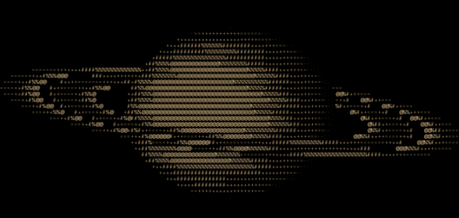

# 💫 Profile: Lucius

<!-- 

Banner: girl ame 13 by akiame{秋雨}
-->

==================================================
              ASCII MATH SHADER v1.0              
        Real-time Vector Projection Engine
        Dato: 2026-11-08 | System status: ONLINE

**Current Status:** Software Engineering student at the University of Southern Denmark (SDU), actively developing my programming and engineering skills.

**Experience:** 
- Software Engineering Student at SDU (University of Southern Denmark)
- Developing high-performance ASCII graphics tools & custom vector render pipelines

**Tech Stack:** Core skills in programming languages and data tools such as C#, Python, and Rust.

**Interests:** Passionate about Data Science, AI/ML, Automation, and Software Development/Engineering.
